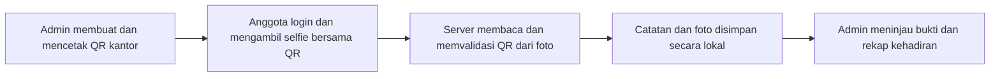

<div align="center">

# Hadir

**Sistem absensi magang lokal berbasis selfie dan QR kantor.**

Kelola anggota, jadwal, dan bukti kehadiran dalam satu aplikasi web — dengan data yang disimpan di komputer sendiri.

**React 19** · **TypeScript** · **Vite 8** · **Node.js 24+** · **SQLite**

</div>

---

## Tentang Hadir

**Hadir** membantu pengelolaan absensi peserta magang melalui foto yang memperlihatkan **wajah peserta dan QR kantor dalam satu gambar**. Aplikasi membaca QR dari foto secara otomatis, menyimpan catatan kehadiran, lalu menyediakan bukti foto untuk ditinjau admin.

Aplikasi berjalan secara lokal (*local-first*), tanpa memerlukan layanan cloud untuk server dan penyimpanan data. **Saat ini, aplikasi hanya dapat diakses dari komputer yang menjalankan server**, bukan dari perangkat lain melalui jaringan.

### Fitur utama

| Admin | Anggota magang |
| --- | --- |
| Membuat dan mengelola akun anggota | Absen masuk dan pulang dengan selfie + QR |
| Mengatur hari kerja, jam, dan zona waktu | Melihat riwayat kehadiran sendiri |
| Membuat, mencetak, dan menghapus QR kantor | Memperbarui nama, email, dan kata sandi |
| Meninjau bukti foto dan status kehadiran | Melihat status peninjauan absensi |
| Memfilter rekap dan mengekspor Excel (.xlsx) | Mengakses aplikasi melalui akun pribadi |
| Mengelola peran dan status anggota | — |

> [!NOTE]
> Sistem **memvalidasi QR pada foto**, bukan mengenali identitas wajah secara otomatis. Bukti wajah diperiksa oleh admin.

## Cara kerja



Alur penggunaan pertama kali:

1. Buat **akun admin pertama** setelah aplikasi dijalankan. Tidak ada akun atau kata sandi bawaan.
2. Buka **Pengaturan** untuk menentukan hari kerja, jam masuk, jam pulang, dan zona waktu.
3. Tambahkan akun melalui **Anggota magang**, kemudian sampaikan kredensial awal kepada masing-masing anggota secara aman.
4. Buat dan cetak QR melalui **QR kantor**, lalu tempatkan di lokasi yang terang dan mudah terlihat.
5. Anggota membuka **Absensi saya**, mengambil foto yang menampilkan wajah serta QR, lalu mengirim absensi.
6. Admin memeriksa bukti di rekap, memberikan hasil peninjauan, dan mengekspor laporan Excel (.xlsx) jika diperlukan.

**Aturan awal:** hari kerja Senin–Sabtu; batas absen masuk pukul **09.00** dan absen pulang mulai **17.00** menurut zona waktu yang dipilih. Admin dapat mengubah jadwal dan mengizinkan absen masuk terlambat. Anggota hanya dapat absen pulang setelah mencatat absen masuk pada hari yang sama. Admin tidak mengisi absensi untuk dirinya sendiri.

## Instalasi dan menjalankan aplikasi

### Persyaratan

- **Node.js 24 atau lebih baru** dan npm.
- Browser modern dengan izin akses kamera untuk mengambil selfie.
- Akses internet untuk mengunduh dependensi pada instalasi pertama.

### 1. Unduh dan instal

```bash
git clone https://github.com/Othelo13/Hadir-Lokal.git
cd Hadir-Lokal
npm ci
```

```bash
node --version
```

Pastikan versi Node.js memenuhi persyaratan sebelum menjalankan aplikasi.

### 2. Jalankan mode pengembangan

```bash
npm run dev
```

Buka **http://127.0.0.1:5197** pada browser di komputer yang sama. Pada kunjungan pertama, aplikasi akan meminta pembuatan admin awal. Folder data serta database dibuat otomatis ketika server mulai berjalan.

Perubahan frontend diperbarui otomatis, sedangkan perubahan file server memicu proses build ulang dan restart server pengembangan.

### 3. Jalankan hasil build

```bash
npm run build
npm start
```

Mode ini tetap menjalankan **server lokal**, bukan menerbitkan aplikasi ke internet. Hentikan server dengan **Ctrl+C**.

> [!TIP]
> Di Windows PowerShell, gunakan `npm.cmd` sebagai pengganti `npm` apabila eksekusi skrip diblokir. Jika port `5197` sudah digunakan, tutup proses Hadir yang berjalan sebelumnya. Server mendengarkan pada `127.0.0.1`, sehingga HP atau komputer lain belum dapat mengaksesnya.

## Teknologi dan arsitektur

| Lapisan | Teknologi | Tanggung jawab |
| --- | --- | --- |
| Antarmuka | React 19, TypeScript, CSS, Lucide React | Dashboard, formulir, kamera, rekap, dan pengaturan |
| Build & development | Vite 8, TypeScript, Prettier | Pengembangan UI, kompilasi, dan format kode |
| Server | Node.js HTTP | Penyajian aplikasi, API, autentikasi, serta validasi |
| Database | SQLite bawaan Node.js (`node:sqlite`) | Anggota, sesi, jadwal, QR, dan catatan absensi |
| Foto & QR | `jpeg-js`, `jsqr`, `qrcode` | Pengolahan JPEG, pembacaan QR, dan pembuatan QR |

Alur data sederhana: **React → API Node.js → SQLite + penyimpanan foto lokal**. Tidak diperlukan database server terpisah.

<details>
<summary><strong>Lihat struktur proyek</strong></summary>

```text
Hadir-Lokal/
├── src/
│   ├── main.tsx             # Entry point React
│   ├── ui.tsx               # Halaman dan interaksi aplikasi
│   ├── PasswordInput.tsx    # Input kata sandi
│   └── styles.css           # Desain antarmuka dan cetak QR
├── server/
│   ├── index.mjs            # Server HTTP lokal
│   ├── api.ts               # Logika API dan absensi
│   ├── auth.mjs             # Autentikasi, profil, dan sesi
│   ├── member-policy.mjs    # Aturan pengelolaan anggota
│   ├── storage.mjs          # Akses SQLite dan penyimpanan foto
│   └── schema.sql           # Skema database
├── scripts/
│   ├── build-server.mjs     # Menghasilkan server/api.mjs
│   └── dev.mjs              # Mode pengembangan
├── index.html
├── package.json
├── package-lock.json
├── tsconfig.json
└── vite.config.ts
```

`dist/`, `node_modules/`, dan `server/api.mjs` dihasilkan secara lokal dan tidak disertakan dalam Git. File `package-lock.json` disertakan agar instalasi dependensi konsisten.

</details>

## Akun, peran, dan keamanan

- **Login dan sesi:** sesi berlaku selama 12 jam, menggunakan cookie `HttpOnly` dan `SameSite=Strict`. Kata sandi disimpan sebagai hash **scrypt**.
- **Profil:** anggota dapat mengubah nama, email login, dan kata sandi. Perubahan profil memerlukan kata sandi saat ini; email harus unik.
- **Pencabutan sesi:** perubahan email mengeluarkan sesi pada browser lain, sedangkan perubahan atau reset kata sandi mencabut sesi lama.
- **Pengelolaan admin:** hanya admin yang dapat mengangkat admin lain. Minimal satu admin aktif harus dipertahankan.
- **Penghapusan anggota:** akun dan sesi anggota dihapus, tetapi catatan absensi serta bukti foto sebelumnya tetap disimpan. Admin harus terlebih dahulu mengubah perannya menjadi anggota sebelum akun dapat dihapus.
- **QR kantor:** QR yang dihapus tidak lagi berlaku untuk absensi berikutnya; catatan lama tidak ikut dihapus.
- **Pemulihan kata sandi:** dilakukan oleh admin melalui daftar anggota; pemulihan melalui email belum tersedia.

Tab pada profil browser yang sama berbagi sesi login. Untuk menguji akun admin dan anggota secara bersamaan, gunakan profil browser berbeda atau jendela samaran.

## Data, privasi, dan pencadangan

Data aplikasi disimpan **di komputer tempat server berjalan**, dengan lokasi berikut:

| Lokasi | Isi |
| --- | --- |
| `data/hadir.sqlite` | Akun, hash kata sandi, sesi, jadwal, QR, dan riwayat absensi |
| `data/selfies/` | Foto bukti kehadiran |
| `data/` | Folder yang perlu disertakan saat membuat cadangan |

**Membuat cadangan:** hentikan server dengan `Ctrl+C`, lalu salin seluruh folder `data/` ke tempat pribadi yang aman. Untuk pemulihan, hentikan server dan kembalikan folder tersebut dari cadangan.

> [!WARNING]
> Foto absensi dan identitas anggota merupakan data pribadi. Batasi akses ke komputer serta berkas cadangan, dan tentukan kebijakan penyimpanan/penghapusan sesuai kebutuhan organisasi. Aplikasi **belum menyediakan penghapusan foto otomatis berdasarkan masa retensi**.

Folder `data/`, database SQLite, foto, sertifikat, dan berkas rahasia dikecualikan oleh `.gitignore`. Jangan pernah memasukkan folder data atau cadangan ke repositori publik.

Nama dan email yang tersimpan pada catatan absensi lama tetap mencerminkan identitas saat absensi dibuat, meskipun profil anggota kemudian berubah.

## Pengembangan dan pemeriksaan kode

```bash
npm run dev
npm run build
npm run format:check
npx tsc --noEmit --noUncheckedSideEffectImports
npm run check:local
```

Untuk menerapkan format kode:

```bash
npm run format
```

Perintah di atas mencakup build, pemeriksaan format, dan pemeriksaan tipe TypeScript. **Belum ada skrip pengujian otomatis (`npm test`) yang dikonfigurasi** pada versi repositori ini; keberhasilan build tidak sama dengan pengujian fungsional menyeluruh.

### Batasan saat ini

- Aplikasi secara default hanya mendengarkan pada `127.0.0.1`. Akses melalui tunnel dapat mengeksposnya ke pihak lain dan belum direkomendasikan untuk data pribadi sungguhan tanpa peninjauan keamanan terpisah.
- QR dibaca otomatis dari foto, tetapi **wajah ditinjau manual oleh admin**. Belum ada pengenalan wajah, pemeriksaan keaktifan wajah (*liveness detection*), atau verifikasi GPS.
- Foto untuk absensi aktif tetap tersimpan. Pembatalan absensi oleh admin menghapus foto terkait dan mempertahankan metadata pembatalan; belum ada aturan retensi otomatis untuk foto absensi aktif.
- Rekap mengambil maksimal **2.000 catatan terbaru** untuk admin dan **1.000 catatan terbaru** untuk anggota. Filter serta ekspor Excel hanya bekerja pada catatan yang sudah dimuat.
- Reset kata sandi dilakukan oleh admin, bukan melalui tautan email.

### Pengujian integritas data lokal

Setelah menghentikan server atau saat server tetap berjalan tanpa aktivitas absensi, jalankan:

```bash
npm run check:local
```

Pemeriksaan ini **hanya membaca** database dan memeriksa keberadaan file selfie; tidak mengubah catatan, foto, atau sesi. Hasil menampilkan jumlah absensi aktif, jumlah pembatalan, anomali foto, dan sidik jari ringkas data. Untuk membandingkan persistensi, jalankan sebelum dan setelah restart server tanpa melakukan absensi di antaranya. Sidik jari akan tetap sama jika data yang diperiksa tidak berubah.

Cookie login memakai `HttpOnly` dan `SameSite=Strict`. Pada HTTP lokal atribut `Secure` tidak dipasang; sebelum menggunakan HTTPS melalui tunnel publik, verifikasi pengaturan cookie, host, origin, dan kontrol akses secara terpisah.

## Lisensi

Repositori ini **belum memiliki berkas `LICENSE`**. Ketentuan penggunaan, modifikasi, dan distribusi ulang kode belum diberikan melalui lisensi open-source. Hubungi pemilik repositori jika membutuhkan izin penggunaan di luar hak yang diberikan oleh platform GitHub.

---

<div align="center">
  <sub>Hadir — pencatatan kehadiran magang dengan data yang tetap berada di komputer lokal.</sub>
</div>
